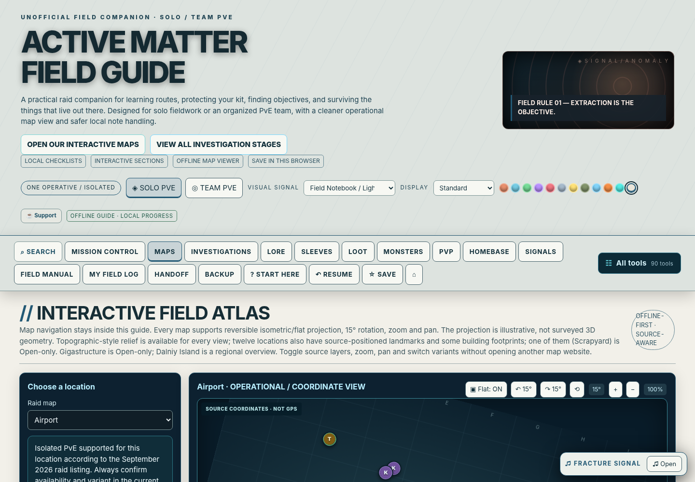

# ACTIVE MATTER // FIELD OPERATIONS — Community Edition

**Version:** 2.1.1 · **Updated:** October 20, 2026 · **Status:** free community download available; GitHub Pages setup pending

> Independent fan-made reference tool. Not affiliated with or endorsed by the Active Matter developers. It does not read, alter, inject into, or automate the game.

**Open immediately:** [Launch the guide](./active_matter_solo_pve_field_guide.html) by downloading and opening the HTML, or [download the complete ZIP](./downloads/Active_Matter_Field_Operations_2_1_1_Community_Edition.zip). Once GitHub Pages is enabled, the site landing page (`index.html`) also provides a browser launch option.

## Support the guide

The project is free and always optional to support: [☕ Buy Me a Coffee](https://buymeacoffee.com/elderdrake). No subscriptions or donation-gated features.

## Instructions for players

**[Read the full player guide](docs/PLAYER_GUIDE.md)** for installation, PvE and PvP, rotating maps, collectibles, backup/restore, and troubleshooting.

## What it does

- **14 interactive maps** with flat and pseudo-isometric viewing, rotation, zoom and manual map notes; 12 with limited community-derived coordinate markers.
- **PvE and optional PvP:** Solo/Team PvE checklists, a separate Open Solo/Squad PvP field log, route planning and investigation progress.
- **20 monster/anomaly dossiers**, 53 curated investigation chains with 217 documented criteria (coverage is **not** guaranteed exhaustive).
- **Signal Archive:** personal music collectible field journal, cited community location leads and 11 original synthesizer tracks.
- **12 themes**, guided tour, Homebase explainer, quick navigation and exportable browser-local backups.
- **Fully offline gameplay companion:** no login, subscription, overlay, game-memory inspection or mod installation.

## Quick start

1. Download and extract the [complete ZIP](./downloads/Active_Matter_Field_Operations_2_1_1_Community_Edition.zip).
2. Open `active_matter_solo_pve_field_guide.html` in Chrome, Edge or another modern browser.
3. Choose your mode and explore. Ctrl+K opens the guide search.
4. Before updating or moving the HTML, **Backup → Export complete backup** and keep that JSON file safe. Browser `file://` storage can vary by path and browser.

> **Maps are not guaranteed 1:1 game geography.** Artwork is original illustrative scenery; community-sourced coordinate markers have their own provenance. The isometric tilt is a 2D projection, not measured elevation. A same-crop current in-game screenshot plus verified permissions is required for game-exact rendering. See [map accuracy notes](docs/MAP_PROVENANCE_AND_ACCURACY.md).

## Latest online map correlation — 20 October 2026

**[Read the full 14-map / 30-variant source audit](docs/ONLINE_MAP_CORRELATION_2026_10_20.md)** · [Machine-readable source citations and version constraints](map-evidence/online_source_correlation_2026_10_20.json). The all-map dashboard now exposes **all 30 individually checked source reference URLs** with area classifications, game-patch caveats and reference-reported extraction-system counts. These counts describe the reference site's candidate system and **are not certified current extract positions**.

Critical accuracy differences: Headquarters and Airport are both **Africa**, Military Base: Unstable Zone opens only one of 40 potential exits, and Dalniy regional overview is not an extra raid. The 275 historic guide markers have not been overwritten.

## New coordinate crosswalk: 201 legacy samples reconciled to game-world X/Z

[Source-derived coordinate QA and 12-map table](docs/GAME_WORLD_COORDINATE_CROSSWALK.md) · [Downloadable JSON](map-evidence/world_coordinate_crosswalk_2026_10_20.json) · [Reference Atlas converter](tools/map_reference_atlas.html).

Of 275 older source-coordinate entries, **201 could be linked to the imported game-world coordinate representation** from the same third-party source. Fitting a separate percent→world X/Z transform per map and withholding independent source entries produced a maximum per-map internal check RMS of 0.067 m. This is **dataset agreement, NOT independently validated live-game location accuracy**; it does not supply 3D building height or game-exact raster backgrounds. The reference atlas includes a world X/Z lookup and a provisional crosshair only after screenshot-specific calibration.

## Screenshot-based tactical Reference Atlas (new)

[**Open the Reference Atlas**](tools/map_reference_atlas.html) — real-overhead-image viewer for all **14 guide views / 30 documented variants / 275 historic source candidate points**. Drag/zoom your own current game screenshot (file stays in the browser), inspect community sample markers by name, and import your own [Map Reconciliation Workbench](tools/map_reconciliation.html) evidence to project pins **only after** checking build, play mode, named raid variant, physical-landmark FIT/CHECK controls, screenshot identity and crop. Historic sources with a different map crop cannot be used directly. Public reference URLs are linked for comparison; third-party image tiles are not repackaged. **This tool does not make the existing 14 illustrated guide backgrounds game-exact.**

## Interactive map-fidelity board

**[Open the 14-map visual QA board](tools/map_fidelity_dashboard.html)**. It displays the status of each illustrated map, legacy sample coverage, patch risks, a link into that map's local screenshot-alignment workspace, and your local per-marker review count when the browser shares storage. This board is an **evidence management interface**, not a new set of accurate geographical baselayers.

## Authentic in-game-overhead source research

[20 October source/rights discovery](docs/AUTHENTIC_MAP_TILE_SOURCE_DISCOVERY.md) documents a public, tile-based source basemap at Active Matter Help. It is a promising **reference** for tracing real roads, hangars and terrain in the Airport benchmark. Source-tile ownership, coordinates and current-build raid boundaries still need verification; the project does not bundle or mirror those third-party images yet.

## High-fidelity map rebuild — underway

**[Full 14-map production register](docs/MAP_PRODUCTION_REGISTER.md)** · [Master roadmap](docs/MAP_FIDELITY_MASTER_ROADMAP.md) · [Airport benchmark](docs/AIRPORT_BENCHMARK.md) · [Machine-readable fidelity register](map-evidence/map_fidelity_register.v1.json)

As of October 20, **0/14 illustrated basemaps are certified against authentic same-build game overhead imagery**, and **0/275 legacy candidate marker coordinates are authenticated as current**. The production register provides a precise release gate rather than implying that plausible artwork equals real geography. The workbench now supports **two-image fixed-physical-landmark FIT/CHECK alignment**, alongside imported historic marker evidence. This is a production capability, not a statement that the actual map content has already been rebuilt.

## Map Reconciliation Workbench — screenshots first

**[Open the updated Map Reconciliation Workbench source](tools/map_reconciliation.html)** · [How to use it](docs/MAP_WORKBENCH_USER_GUIDE.md) · [QA report](docs/MAP_WORKBENCH_QA.md)

This free, offline companion utility aligns **your own current in-game screenshots** to 275 historic community marker samples. It records **fit points and independent held-out check points**, computes separate 2D alignment-error estimates, and exports local evidence JSON without uploading screenshots. It does not automatically produce game-exact terrain, actual game icon graphics, or building heights. **The October 20 source update is newer than the packaged 2.1.1 ZIP; the ZIP may contain the older workbench.** See [map evidence requirements](docs/MAP_FIDELITY_EVIDENCE.md).

## Original concept art add-on — offline guide portraits

The earlier [Editorial Artwork Upgrade](tools/editorial_art_upgrade.html) now generates a **new standalone HTML guide** with an embedded 16-scene AI-generated editorial sprite. It adds atmospheric side portraits to the Monster Compendium, body sleeves, loot cards, weapon catalog and selected lore. This is **original illustrative concept art**, not an exact representation of any game monster, weapon or location. Multiple records currently share category-level images, not individually researched official depictions.

1. Open your current guide and **Backup → Export complete backup** first.
2. Download or open [the local-upgrade tool](tools/editorial_art_upgrade.html), choose the 2.1.1 HTML, and click **Build upgraded standalone guide**. The browser creates a new `*_with_editorial_art.html` locally; it does not upload your guide or change the original source file.
3. Open the downloaded HTML and import your backup if file-path localStorage isolation hides saved progress. The images run offline and can be toggled from the Monster Compendium.

**Accuracy gate:** This release adds pictures alongside encyclopedia entries, **not corrected geographic basemaps**. The live [community interactive atlas](https://activematter.guide/maps/) and [Active Matter Help map pages](https://activematterhelp.ru/wiki/maps/africa_headquarters) are external map references; their existence does not grant image or coordinate-dataset redistribution permission. Source-based map verification and building-height evidence remain outstanding. See [map reconciliation register](docs/MAP_MARKER_RECONCILIATION_STATUS.md) and [map-fidelity criteria](docs/MAP_FIDELITY_EVIDENCE.md).

### New 2.1.2 original-art installer (optional, source-only)

The [2.1.2 visual installer](tools/visual_upgrade_2_1_2.html) contains **32 original category-level concept scenes**, builds a new copy of the user's existing standalone HTML locally, and preserves the original file. The user should export a full progress backup beforehand. Its 16 new images are atmospheric concepts rather than guaranteed faithful creature/weapon models or real map basemaps. The 2.1.2 installer has been smoke-tested against an earlier guide edition; **a full actual-browser acceptance run with the exact current 2.1.1 distribution remains outstanding**. The 2.1.1 ZIP has not been changed by this source-only installer addition.

## Share & contribute

Found a wrong loot lead, a missing monster behavior, a broken control or a patch change? Open a GitHub **Issue** using the templates in `.github/ISSUE_TEMPLATE/`. Include the current game patch, mode/variant, map, and evidence when you can. See [CONTRIBUTING.md](CONTRIBUTING.md).

**Please do not post personal browser backup files, authentication tokens, game account credentials or copyrighted in-game map textures in issues.**

## Development and testing

Development follows a layered *lasagna architecture*. New UI/features/persistence logic live in focused `source/modules/` files; a bundled single HTML is shipped for easy offline use. See [developer notes](source/README_DEV.md) and [2.1 QA report](docs/TEST_REPORT_2.1.md). The automated browser tests use in-memory browser storage, **not actual `file://` persistence**; testers should verify backups manually.

## Credits and rights

- Active Matter is the intellectual property of its respective creators and publisher.
- Music in this project was procedurally synthesized for this guide; see [audio permissions](docs/ORIGINAL_AUDIO_PERMISSIONS.md).
- Original tactical artwork is **not official game imagery**. Coordinate sample provenance and third-party map-data considerations: [map source notes](docs/MAP_PROVENANCE_AND_ACCURACY.md).
- No general software license has been selected for the source repository yet. Public visibility does not automatically grant permission for reuse; see [RIGHTS_AND_ATTRIBUTION.md](RIGHTS_AND_ATTRIBUTION.md).

[Release notes](docs/CHANGELOG_2.1.md) · [Full offline ZIP](downloads/Active_Matter_Field_Operations_2_1_1_Community_Edition.zip) · [Steam community discussion](https://steamcommunity.com/app/2887580/discussions/0/569300630414416421/)
