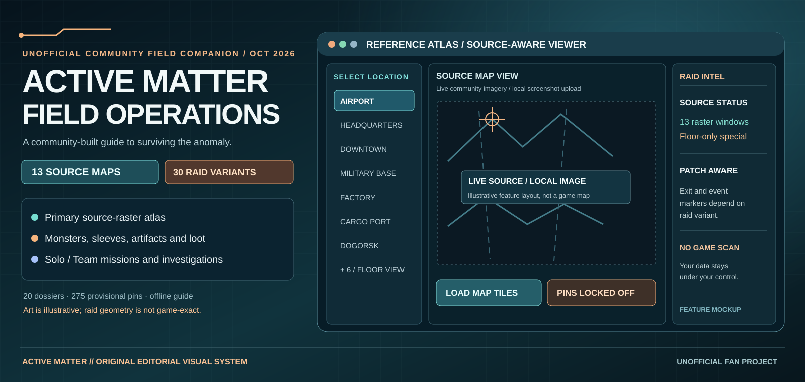
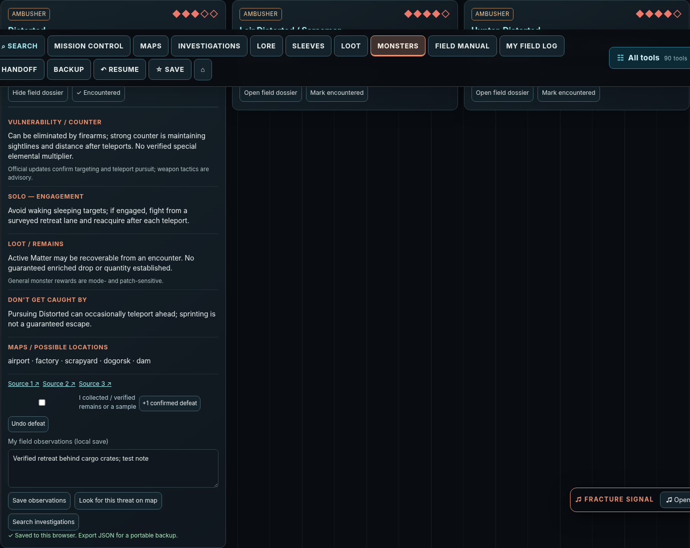

# ACTIVE MATTER // FIELD OPERATIONS — Community Edition

*Original editorial mockup, not a game screenshot. The primary map workflow now opens the source-hosted raster atlas. Live tiles load only on user opt-in; the offline 2.1.1 HTML/ZIP still contains illustrative legacy maps.*

See an actual guide screenshot: Monster &amp; Anomaly Compendium

**Legacy companion:** 2.1.1 · **Maps-only alpha:** v2.2.0-alpha.1 · **Vercel production deployment:** Ready (per Vercel dashboard) · **GitHub Pages:** disabled · **Formal GitHub Release:** pending.

> Independent fan-made reference tool. Not affiliated with or endorsed by the Active Matter developers. It does not read, alter, inject into, or automate the game.

**🌐 [Open Active Matter Field Operations — public website](https://activematterguide.vercel.app/)** · **[Launch Source Atlas directly](https://activematterguide.vercel.app/tools/all_maps_live_reference.html)**

Vercel reports the production deployment as **Ready** for `main`. The live host could not be independently fetched from the assistant's restricted network at the time of this update; please report any 404, authentication page, or missing map tiles. The 13-area source viewer streams third-party tiles only after explicit opt-in. Gigastructure remains floor-only. GitHub's HTML file views remain code previews, not the hosted app.

**[Download the Source Atlas v2.2.0-alpha.1 — maps-only ZIP](https://github.com/arch-drake/ActiveMatterGuide/blob/alpha/v2.2.0-alpha.1/downloads/ActiveMatter-SourceAtlas-v2.2.0-alpha.1-MAPS-ONLY.zip)** (GitHub file page: use the download icon). Extract and open its **index.html**. This preview contains the four map/evidence tools, not the older full PvE/PvP companion. The [entire alpha branch ZIP](https://github.com/arch-drake/ActiveMatterGuide/archive/refs/heads/alpha/v2.2.0-alpha.1.zip) includes the old companion and all repository source as well. **There is no formal GitHub Release yet:** the automated publication workflow failed before executing its first step (runner provisioning). Pages is also disabled.

**Download and launch (working without GitHub Pages):** [Download the complete current repository ZIP](https://github.com/arch-drake/ActiveMatterGuide/archive/refs/heads/main.zip), extract it, and open **index.html** in Chrome or Edge. The first homepage action opens **Explore Source Atlas**. Source tiles require internet and your explicit opt-in. For the older offline companion, use [the separate 2.1.1 ZIP](./downloads/Active_Matter_Field_Operations_2_1_1_Community_Edition.zip).

**Important GitHub link behavior:** GitHub's file-view pages for [Source Atlas HTML](./tools/all_maps_live_reference.html) and [field guide HTML](./active_matter_solo_pve_field_guide.html) show/download source files; they are **not a hosted, interactive launch page**. The GitHub Pages URL is **not active yet**, so use the ZIP method above. The [alpha candidate branch download](https://github.com/arch-drake/ActiveMatterGuide/archive/refs/heads/alpha/v2.2.0-alpha.1.zip) is published as source. The standalone maps-only alpha ZIP is present in that branch. A *formal* GitHub prerelease is still blocked by the Actions runner failure and must not be claimed as published.

## Vercel hosting (production deployment Ready; browser acceptance still pending)

The repository includes [static Vercel configuration](vercel.json) and [deployment guidance](docs/DEPLOY_VERCEL.md) for the existing repo. Vercel's project dashboard now shows production **Ready** and advertises [activematterguide.vercel.app](https://activematterguide.vercel.app/). Framework is **Other**, website root is `.`, and no build is needed. Full public browser-route checks and third-party tile delivery remain **unverified**. GitHub Pages is still a separate setting.

## Support the guide

The project is free and always optional to support: [☕ Buy Me a Coffee](https://buymeacoffee.com/elderdrake). No subscriptions or donation-gated features.

## Instructions for players

**[Read the full player guide](docs/PLAYER_GUIDE.md)** for installation, PvE and PvP, rotating maps, collectibles, backup/restore, and troubleshooting.

## What it does

- **Primary map viewer:** 13 game-derived community-hosted raster reference windows (including Dalniy Island regional), explicitly opt-in tile downloads, zoom/pan, raid-variant source links and **no unaligned marker overlays**. Gigastructure is a separate floor-only upload workspace. The older offline companion still has 14 *illustrative* panels and legacy marker candidates.
- **PvE and optional PvP:** Solo/Team PvE checklists, a separate Open Solo/Squad PvP field log, route planning and investigation progress.
- **20 monster/anomaly dossiers**, 53 curated investigation chains with 217 documented criteria (coverage is **not** guaranteed exhaustive).
- **Signal Archive:** personal music collectible field journal, cited community location leads and 11 original synthesizer tracks.
- **12 themes**, guided tour, Homebase explainer, quick navigation and exportable browser-local backups.
- **Fully offline gameplay companion:** no login, subscription, overlay, game-memory inspection or mod installation.

## Primary map presentation and accuracy — 20 October 2026

The **[Source Raster Atlas](tools/all_maps_live_reference.html)** is the public default map path. Its 13 front-facing reference areas are **Airport, Headquarters, Downtown, Dam, Cargo Port, Factory, Dogorsk, Military Base, Ozernoe, Park, Scrapyard, Shegolskoe and Dalniy Island regional overview**. Overhead rasters are requested from the community host *only after the user clicks* **Load overhead map**; third-party map images are not copied into this repository. Some areas share a regional source image, so the 4×4 tile windows are **not certified exact per-raid boundaries**.

**Gigastructure is not a normal supported flat map.** It is listed under **Special / In progress** for separately labeled local floor-reference images; no unverified floor plan, surveyed elevation or building height is invented. **All 275 historic source-relative marker positions are still candidates.** The primary atlas **draws no marker overlay at all** on its live raster or user image, because coordinates have not been independently reconciled. Extracts, timed extractions, dynamic events, anomalies, Unstable Zone points and spawn-group restrictions must be separately checked for the current game build and raid variant.

For research only, the [Screenshot Evidence Atlas](tools/map_reference_atlas.html) and [Map Reconciliation Workbench](tools/map_reconciliation.html) retain manually gated calibration/evidence workflows. These require matching build, mode, raid variant, screenshot identity, source crop and held-out landmark validation before historic candidate pins can be previewed. Such opt-in overlays remain **provisional**, not authoritative live positions.

**Distribution boundary:** the packaged `active_matter_solo_pve_field_guide.html` and existing downloadable 2.1.1 ZIP have **not** been silently repackaged. They still include the old illustrative basemaps and historic candidate markers as part of the offline tracking companion. Use the newer Atlas for map viewing and treat legacy pins as research leads, not verified coordinates.

## Quick start

1. Download and extract the [complete source repository ZIP](https://github.com/arch-drake/ActiveMatterGuide/archive/refs/heads/main.zip) to get the **current Source Atlas**. For legacy-only use, the [2.1.1 companion ZIP](./downloads/Active_Matter_Field_Operations_2_1_1_Community_Edition.zip) is still available.
2. Open **index.html**, then **Explore Source Atlas** to view the 13 primary raster references (tiles load only when you click). Or open **active_matter_solo_pve_field_guide.html** to use the separate older offline guide.
3. The legacy guide offers Solo/Team and PvP modes and Ctrl+K search.
4. Before updating or moving the HTML, **Backup → Export complete backup** and keep that JSON file safe. Browser `file://` storage can vary by path and browser.

> **Maps are not guaranteed 1:1 game geography.** Artwork is original illustrative scenery; community-sourced coordinate markers have their own provenance. The isometric tilt is a 2D projection, not measured elevation. A same-crop current in-game screenshot plus verified permissions is required for game-exact rendering. See [map accuracy notes](docs/MAP_PROVENANCE_AND_ACCURACY.md).

## Latest online map correlation — 20 October 2026

**[Read the full 14-map / 30-variant source audit](docs/ONLINE_MAP_CORRELATION_2026_10_20.md)** · [Machine-readable source citations and version constraints](map-evidence/online_source_correlation_2026_10_20.json). The all-map dashboard now exposes **all 30 individually checked source reference URLs** with area classifications, game-patch caveats and reference-reported extraction-system counts. These counts describe the reference site's candidate system and **are not certified current extract positions**.

Critical accuracy differences: Headquarters and Airport are both **Africa**, Military Base: Unstable Zone opens only one of 40 potential exits, and Dalniy regional overview is not an extra raid. The 275 historic guide markers have not been overwritten.

## New coordinate crosswalk: 201 legacy samples reconciled to game-world X/Z

[Source-derived coordinate QA and 12-map table](docs/GAME_WORLD_COORDINATE_CROSSWALK.md) · [Downloadable JSON](map-evidence/world_coordinate_crosswalk_2026_10_20.json) · [Reference Atlas converter](tools/map_reference_atlas.html).

Of 275 older source-coordinate entries, **201 could be linked to the imported game-world coordinate representation** from the same third-party source. Fitting a separate percent→world X/Z transform per map and withholding independent source entries produced a maximum per-map internal check RMS of 0.067 m. This is **dataset agreement, NOT independently validated live-game location accuracy**; it does not supply 3D building height or game-exact raster backgrounds. The reference atlas includes a world X/Z lookup and a provisional crosshair only after screenshot-specific calibration.

## Primary Source Atlas — 13 raster areas + Gigastructure floor references

[**Open All Maps Live Reference Atlas**](tools/all_maps_live_reference.html) · [Download latest repository ZIP](https://github.com/arch-drake/ActiveMatterGuide/archive/refs/heads/main.zip)

The single-HTML viewer makes **13 geographic source references** front-facing and separates **Gigastructure into Special / In progress**. For each referenced geographic area, one opt-in click requests 16 community-hosted game-derived raster tiles (4×4, 2048×2048), with zoom, pan, raid-variant sources and patch warnings. The new primary atlas does **not** project any historical pin coordinates onto these tile windows. Gigastructure uses only a local, floor-labeled screenshot importer; it does not claim a verified overhead floor map. The user-requested standalone ZIP is also saved in the Active Matter Guide project Library. It contains no copied game textures; Internet is required for live tiles.

**Browser QA:** 14 selectors / 30 raid variants / 13 live tile modes and Gigastructure fallback passed in Chromium with network tile requests intercepted and replaced by *clearly labelled test images*. This validates UI wiring, not real-world tile delivery, game-geographic alignment, or copyrights. Tests made **zero third-party requests before user opt-in**; no browser script errors occurred.

## Real top-down raster imagery for all available world regions — opt-in online viewer

The [Reference Atlas](tools/map_reference_atlas.html) now offers a **Load game-derived online map tiles** button for **13 of the 14 guide views** (nine local Dalniy raids, Africa's Airport/Headquarters, Downtown and the Dalniy regional overview). It loads genuine game-geometry imagery **directly from the community tile host**, without copying it into our distributable package. Preview anchors were recovered from actual raid wiki images rather than invented. The zoom/pan viewer uses a four-by-four 512-pixel tile mosaic at the source preview's indexed zoom level. Internet is required and tiles are requested only after the user clicks.

**Caveats:** These are source tile neighborhoods, not surveyed raid-only crop boundaries. Nearby maps in the same source region share the same geographic tile layer; the HQ/Airport preview uses the shared Africa atlas area, not independently calibrated exact-raid rectangles. The live tile layer explicitly blocks our legacy marker overlays because their source percentages have NOT been matched to tile-pyramid pixels. Gigastructure has **no verified overhead tile source**; use its official/community source link and separately captured floor maps rather than inventing buildings or floor heights. Tile images belong to the source site's respective rights holders. Offline original map illustrations remain separate.

## Screenshot-based tactical Reference Atlas (new)

[**Open the Reference Atlas**](tools/map_reference_atlas.html) — real-overhead-image viewer for all **14 guide views / 30 documented variants / 275 historic source candidate points**. Drag/zoom your own current game screenshot (file stays in the browser), inspect community sample markers by name, and import your own [Map Reconciliation Workbench](tools/map_reconciliation.html) evidence to project pins **only after** checking build, play mode, named raid variant, physical-landmark FIT/CHECK controls, screenshot identity and crop. Historic sources with a different map crop cannot be used directly. Public reference URLs are linked for comparison; third-party image tiles are not repackaged. **This tool does not make the existing 14 illustrated guide backgrounds game-exact.**

## Interactive map-fidelity board

**[Open the 14-map visual QA board](tools/map_fidelity_dashboard.html)**. It displays the status of each illustrated map, legacy sample coverage, patch risks, a link into that map's local screenshot-alignment workspace, and your local per-marker review count when the browser shares storage. This board is an **evidence management interface**, not a new set of accurate geographical baselayers.

## Authentic in-game-overhead source research

[20 October source/rights discovery](docs/AUTHENTIC_MAP_TILE_SOURCE_DISCOVERY.md) documents a public, tile-based source basemap at Active Matter Help. It is a promising **reference** for tracing real roads, hangars and terrain in the Airport benchmark. Source-tile ownership, coordinates and current-build raid boundaries still need verification; the project does not bundle or mirror those third-party images yet.

## High-fidelity map rebuild — underway

**[Full 14-map production register](docs/MAP_PRODUCTION_REGISTER.md)** · [Master roadmap](docs/MAP_FIDELITY_MASTER_ROADMAP.md) · [Airport benchmark](docs/AIRPORT_BENCHMARK.md) · [Machine-readable fidelity register](map-evidence/map_fidelity_register.v1.json)

As of October 20, **0/14 illustrated basemaps are certified against authentic same-build game overhead imagery**, and **0/275 legacy candidate marker coordinates are authenticated as current**. The production register provides a precise release gate rather than implying that plausible artwork equals real geography. The workbench now supports **two-image fixed-physical-landmark FIT/CHECK alignment**, alongside imported historic marker evidence. This is a production capability, not a statement that the actual map content has already been rebuilt.

## Map Reconciliation Workbench — screenshots first

**[Open the updated Map Reconciliation Workbench source](tools/map_reconciliation.html)** · [How to use it](docs/MAP_WORKBENCH_USER_GUIDE.md) · [QA report](docs/MAP_WORKBENCH_QA.md)

This free, offline companion utility aligns **your own current in-game screenshots** to 275 historic community marker samples. It records **fit points and independent held-out check points**, computes separate 2D alignment-error estimates, and exports local evidence JSON without uploading screenshots. It does not automatically produce game-exact terrain, actual game icon graphics, or building heights. **The October 20 source update is newer than the packaged 2.1.1 ZIP; the ZIP may contain the older workbench.** See [map evidence requirements](docs/MAP_FIDELITY_EVIDENCE.md).

## Original concept art add-on — offline guide portraits

The earlier [Editorial Artwork Upgrade](tools/editorial_art_upgrade.html) now generates a **new standalone HTML guide** with an embedded 16-scene AI-generated editorial sprite. It adds atmospheric side portraits to the Monster Compendium, body sleeves, loot cards, weapon catalog and selected lore. This is **original illustrative concept art**, not an exact representation of any game monster, weapon or location. Multiple records currently share category-level images, not individually researched official depictions.

1. Open your current guide and **Backup → Export complete backup** first.
2. Download or open [the local-upgrade tool](tools/editorial_art_upgrade.html), choose the 2.1.1 HTML, and click **Build upgraded standalone guide**. The browser creates a new `*_with_editorial_art.html` locally; it does not upload your guide or change the original source file.
3. Open the downloaded HTML and import your backup if file-path localStorage isolation hides saved progress. The images run offline and can be toggled from the Monster Compendium.

**Accuracy gate:** This release adds pictures alongside encyclopedia entries, **not corrected geographic basemaps**. The live [community interactive atlas](https://activematter.guide/maps/) and [Active Matter Help map pages](https://activematterhelp.ru/wiki/maps/africa_headquarters) are external map references; their existence does not grant image or coordinate-dataset redistribution permission. Source-based map verification and building-height evidence remain outstanding. See [map reconciliation register](docs/MAP_MARKER_RECONCILIATION_STATUS.md) and [map-fidelity criteria](docs/MAP_FIDELITY_EVIDENCE.md).

### New 2.1.2 original-art installer (optional, source-only)

The [2.1.2 visual installer](tools/visual_upgrade_2_1_2.html) contains **32 original category-level concept scenes**, builds a new copy of the user's existing standalone HTML locally, and preserves the original file. The user should export a full progress backup beforehand. Its 16 new images are atmospheric concepts rather than guaranteed faithful creature/weapon models or real map basemaps. The 2.1.2 installer has been smoke-tested against an earlier guide edition; **a full actual-browser acceptance run with the exact current 2.1.1 distribution remains outstanding**. The 2.1.1 ZIP has not been changed by this source-only installer addition.

## Share & contribute

Found a wrong loot lead, a missing monster behavior, a broken control or a patch change? Open a GitHub **Issue** using the templates in `.github/ISSUE_TEMPLATE/`. Include the current game patch, mode/variant, map, and evidence when you can. See [CONTRIBUTING.md](CONTRIBUTING.md).

**Please do not post personal browser backup files, authentication tokens, game account credentials or copyrighted in-game map textures in issues.**

## Development and testing

Development follows a layered *lasagna architecture*. New UI/features/persistence logic live in focused `source/modules/` files; a bundled single HTML is shipped for easy offline use. See [developer notes](source/README_DEV.md) and [2.1 QA report](docs/TEST_REPORT_2.1.md). The automated browser tests use in-memory browser storage, **not actual `file://` persistence**; testers should verify backups manually.

## Credits and rights

- Active Matter is the intellectual property of its respective creators and publisher.
- Music in this project was procedurally synthesized for this guide; see [audio permissions](docs/ORIGINAL_AUDIO_PERMISSIONS.md).
- Original tactical artwork is **not official game imagery**. Coordinate sample provenance and third-party map-data considerations: [map source notes](docs/MAP_PROVENANCE_AND_ACCURACY.md).
- No general software license has been selected for the source repository yet. Public visibility does not automatically grant permission for reuse; see [RIGHTS_AND_ATTRIBUTION.md](RIGHTS_AND_ATTRIBUTION.md).

[Release notes](docs/CHANGELOG_2.1.md) · [Full offline ZIP](downloads/Active_Matter_Field_Operations_2_1_1_Community_Edition.zip) · [Steam community discussion](https://steamcommunity.com/app/2887580/discussions/0/569300630414416421/)
